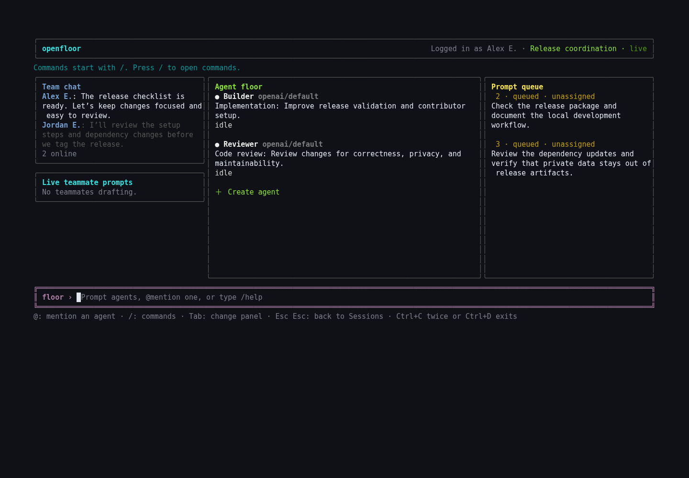
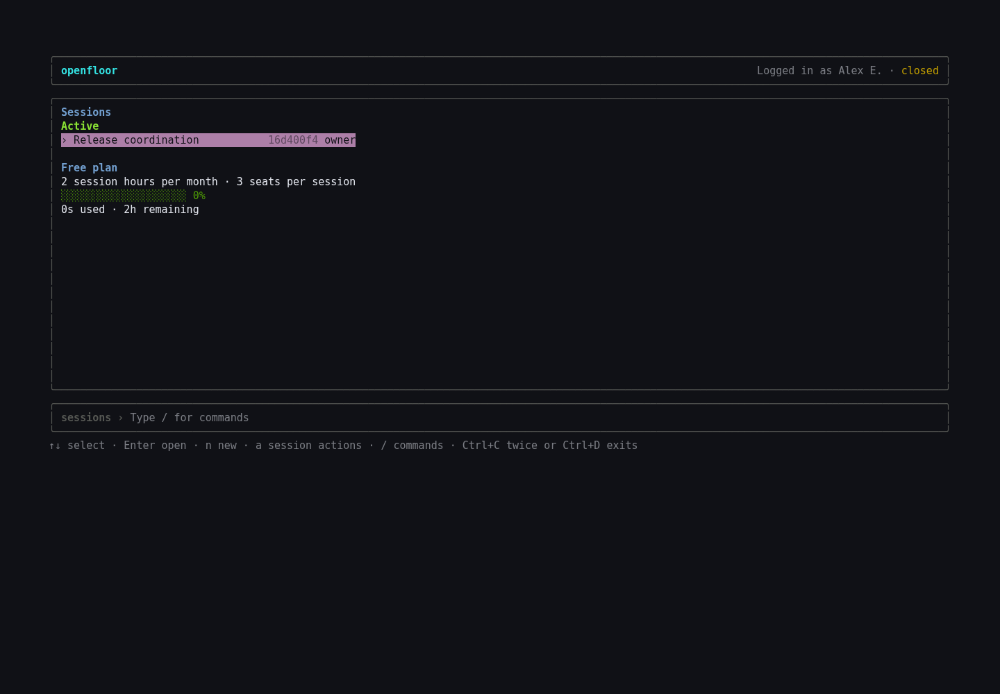

# openfloor CLI

Keyboard-first CLI and TUI for [openfloor](https://github.com/mattdomingo/openfloor), licensed under [Apache 2.0](LICENSE).

## Screenshots

The session floor keeps team chat, agents, and queued prompts visible beside a keyboard-driven command bar.



Choose a shared workspace from Sessions, then press Enter to open its floor.



Captured from the compiled CLI running in a real terminal in the cloud, connected to the locally running openfloor Worker. The disposable test session is also shown in the [web app screenshots](https://github.com/mattdomingo/openfloor#screenshots). No live agent execution is depicted. See [screenshot provenance](docs/images/README.md).

## Requirements

- Node.js 22.13 or newer
- macOS or Linux

## Install

Build from this repository, or use a tarball attached to a GitHub release:

```bash
npm ci
npm run build
npm pack
npm install -g ./openfloor-cli-0.1.0.tgz
openfloor
```

First launch shows the openfloor mark, then checks setup. On macOS, it offers to run `brew install cloudflared` only after explicit confirmation. It opens Cloudflare Access login, collects the initial profile, and guides GitHub device authorization before completing Free onboarding. Browser fallback remains available when device flow is not configured. Setup clears before the TUI starts. Linux users receive Cloudflare's install instructions when `cloudflared` is missing.

Run `openfloor` inside a clean Git clone with a GitHub `origin` to enter repository-matched session creation. A valid active or archived binding instead opens its floor directly. Ended, missing, inaccessible, and repository-mismatched bindings are cleared back into creation. After confirmation, openfloor verifies and checks out the server-created candidate branch, then fast-forwards the worktree whenever shared agent changes integrate. Teammates opening an existing matching session confirm once before their clone is bound. Running outside such a worktree opens Sessions, and `/sessions` remains available from every floor.

Local sync is deliberately receive-only: agents still run in openfloor's isolated remote runtime. The CLI never resets, cleans, commits, or pushes. Uncommitted or diverged work pauses sync without overwriting anything. Local human edits are not uploaded to openfloor.

Every action is also scriptable; use `openfloor --help` and `openfloor <group> --help`. Machine output uses `--json` and never mixes progress into stdout.

## Authentication

`openfloor auth login` delegates to Cloudflare's supported Access flow:

```text
cloudflared access login --no-verbose --app https://app.opnflr.com/api/bootstrap/me
```

The CLI keeps the returned JWT only in memory. `cloudflared` stores its Access state under an owner-only openfloor directory, isolated from `~/.cloudflared`. Later invocations ask it for the cached token. `openfloor auth logout` or TUI `/logout` removes only this isolated cache plus setup/session/workspace identity state, preserves display and server preferences, and exits. It does not revoke the remote Cloudflare session. Existing users authenticate once after upgrading to the isolated cache.

Sessions uses a bottom command bar. Press `/` for selectable inline commands such as `/new`, `/settings`, `/credentials`, `/account`, `/help`, and `/logout`; `/` never filters sessions. `/exit` aliases `/quit` on Sessions. Creation, binding, settings, help, credentials, session actions, removal confirmation, and item details are full terminal pages rather than popups.

Press `a` on a selected session (or `/archive`, `/unarchive`, `/delete`, `/leave` from either command bar) to open the session-actions page. Archive/unarchive apply immediately with a status notice; delete and leave open a confirmation page that discloses a live candidate branch or a still-integrating run instead of retrying a blocked deletion automatically — you choose how to resolve it, then the command runs exactly once. A tone-coded notice line and a header spinner show mutation and background-command progress; `Ctrl+C` arms with a warning naming anything still in flight and exits on a second press within 2 seconds, and `Ctrl+D` on an empty prompt exits immediately — neither cancels a remote run.

## Session floor

- Left: persisted team chat above ephemeral live teammate prompts
- Center: live agent floor
- Right: prompt queue
- Bottom: prompt and slash-command bar

Type ordinary text to add work to the queue. Type `@` to open the session's agent list; it filters as you type and `Tab` (or `Enter`) completes the highlighted agent. Live work appears before completed, failed, cancelled, integrated, answered, or rolled-back items. Use `/chat <message>` for team chat. `/overview`, `/review`, and `/settings` open interactive pages; `/floor` returns; `/sessions` opens session selection. Direct aliases such as `/invite`, `/agents`, `/skills`, and `/runs` execute scriptable groups silently. `/run` remains accepted for compatibility but is hidden from suggestions. Repository work remains available through `openfloor repository …`, not TUI `/repository`.

Prompt input has focus by default. Whatever holds focus is drawn with a doubled magenta border and a `›` title marker, so the focused panel, page, or bar is unambiguous; panels keep their own accent colour while unfocused. Press `Tab`/`Shift+Tab` to cycle chat, live drafts, agents, queue, and prompt forward/backward (`Tab` completes the highlighted suggestion instead while a suggestion list is open); use arrows to select and to scroll a pane past its visible window; Enter opens or acts; Esc returns to prompt. Agent pane's Create row opens a full agent wizard. Review supports Files/Prompts and one-file diffs. Settings toggles owner-authorized routing values. Editable fields support common readline chords (`Ctrl+A`/`E`/`U`/`W`) and Option+Backspace for word deletion; command bars recall history with Up/Down when no suggestions are showing. `Esc` closes an open suggestion list; `Esc` twice clears typed text, and `Esc` twice on an empty bar goes back one page — nested page to Floor, Floor to Sessions, and Sessions command entry to the session list. `/exit` performs the same contextual Back; `/quit` exits. `/sync` retries paused local synchronization.

`/credentials` connects API keys, Claude setup tokens, Kimi plan keys, or ChatGPT `auth.json` through masked write-only input. Secrets never enter shell history, config, logs, realtime drafts, or terminal output. `/account` opens browser-owned profile, billing, GitHub installation, and account controls.

## Local development

```bash
npm ci
npm run dev -- --help
npm run check
```

Use `OPENFLOOR_BASE_URL=http://localhost:3000` for an openfloor development Worker. Loopback skips `cloudflared` and uses the server's loopback development identity.

See [architecture](docs/architecture.md), [security](docs/security.md), [commands](docs/commands.md), [key map](docs/keymap.md), [development](docs/development.md), and [release](docs/release.md).

API contracts were verified against openfloor commit `f6cdccc3074b841d07fcbc4a3731b925699fbb43` on 2026-08-28. Additive response fields remain compatible; missing or wrongly typed required fields produce an actionable compatibility error.


## Contributing and releases

See [CONTRIBUTING.md](CONTRIBUTING.md), [SECURITY.md](SECURITY.md), and the [release workflow](docs/release.md). Release tarballs include the license and attribution notices. `private: true` prevents accidental npm-registry publication; it does not restrict the Apache-licensed source or GitHub release archives.

## License

[Apache License 2.0](LICENSE). See [NOTICE](NOTICE) and [THIRD_PARTY_NOTICES.md](THIRD_PARTY_NOTICES.md) for attribution and dependency licensing.
